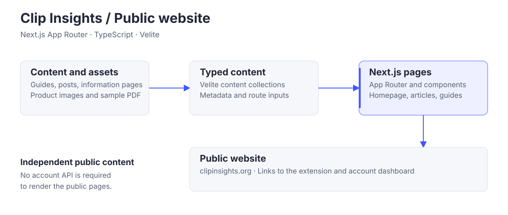

# Clip Insights · Public website

### Discover a better way to learn from video.

The public home of Clip Insights: product information, practical guides, and articles about turning learning videos into useful study notes.

[Visit website](https://clipinsights.org) · [Open web app](https://app.clipinsights.org) · [Install extension](https://chromewebstore.google.com/detail/ccgechmifoecebnimnccgahnoklklilj)

## What visitors find

| Discover | Learn | Try |
| --- | --- | --- |
| The product, its study tools, and account options. | Guides and articles about learning from video. | An illustrative walkthrough and a sample study-notes PDF. |

## How the site works



Written content becomes typed collections through Velite, then Next.js renders the public pages. The website runs independently of account and AI services and directs visitors to the extension and web dashboard.

## Built with

**Next.js App Router · React 19 · TypeScript · Velite · Tailwind CSS**

The site includes product pages, guides, articles, and contact and policy information. Fonts are self-hosted, and the sample PDF is generated with the extension's document renderer.

## Run locally

Use Node.js 22.16 or later. No backend credentials or database are required.

```bash
npm ci
npm run dev
```

Run `npm test`, `npm run lint`, and `npm run build` for verification.

## Explore further

[Detailed architecture](./ARCHITECTURE.md) · [Development guide](./docs/DEVELOPMENT.md) · [Hosting configuration](./DEPLOYMENT.md)

Part of [Clip Insights](https://github.com/Clip-Insights): [Chrome extension](https://github.com/Clip-Insights/chrome-extension) · [web app](https://github.com/Clip-Insights/web-app) · [backend](https://github.com/Clip-Insights/backend).
